# Diagramas de arquitectura de Rin'ne

Esta carpeta contiene los cinco diagramas de arquitectura de la Parte 1 del
entregable. Todos se derivaron del codigo y de la configuracion vigentes en
`main` (commit `87467c37d171274738153c7f9a9ecd77d230f4e2`), no de supuestos.

## Contenido

| # | Diagrama | Fuente Mermaid | Version SVG | Proposito |
| --- | --- | --- | --- | --- |
| 1 | C4 nivel 1 - Contexto | [`01-c4-contexto.mmd`](./01-c4-contexto.mmd) | [`01-c4-contexto.svg`](./01-c4-contexto.svg) | Mostrar Rin'ne como sistema central, sus actores y los sistemas externos que participan en el ciclo de entrega. |
| 2 | C4 nivel 2 - Contenedores | [`02-c4-contenedores.mmd`](./02-c4-contenedores.mmd) | [`02-c4-contenedores.svg`](./02-c4-contenedores.svg) | Descomponer Rin'ne en frontend, API, migrador, PostgreSQL y almacenamiento de archivos. |
| 3 | Componentes del backend | [`03-componentes-backend.mmd`](./03-componentes-backend.mmd) | [`03-componentes-backend.svg`](./03-componentes-backend.svg) | Detallar routers, controllers, services, repositories, middleware, configuracion y migraciones. |
| 4 | Despliegue | [`04-despliegue.mmd`](./04-despliegue.mmd) | [`04-despliegue.svg`](./04-despliegue.svg) | Representar el stack Docker Compose: servicios, red, puertos, volumenes, dependencias y diferencias local/produccion. |
| 5 | Pipeline CI/CD | [`05-pipeline-ci-cd.mmd`](./05-pipeline-ci-cd.mmd) | [`05-pipeline-ci-cd.svg`](./05-pipeline-ci-cd.svg) | Explicar eventos, jobs, pruebas, builds, escaneo Trivy y publicacion condicionada en GHCR. |

## Vista rapida

### 1. C4 nivel 1 - Contexto



Rin'ne es el sistema central. Los actores son el **Visitante** (registro e inicio
de sesion) y el **Usuario registrado** (reproduce audio y gestiona biblioteca,
playlists, favoritos y preferencias). Los sistemas externos representados son
reales y pertenecen a la cadena de entrega: **GitHub** (repositorio y Actions),
**GHCR** (registro de imagenes), **Docker Hub** (imagenes base) y la **base de
datos de vulnerabilidades de Trivy**. No se dibujaron pasarelas de pago, OAuth,
correo, CDN ni servicios cloud porque no existen en el codigo.

### 2. C4 nivel 2 - Contenedores



| Contenedor | Tecnologia | Responsabilidad |
| --- | --- | --- |
| Frontend web | React 19, Vite, TypeScript, Tailwind CSS, Zustand, Howler y Nginx | Sirve la SPA compilada y actua como proxy inverso de `/api` y `/uploads`. |
| API REST | Node.js 22, Express 4, TypeScript, Zod, Passport-JWT, Multer y `pg` | Autenticacion, biblioteca, playlists, favoritos, preferencias, streaming y uploads. |
| Migrador | Node.js 22 y TypeScript, misma imagen que la API | Aplica migraciones versionadas y termina; no atiende trafico. |
| Base de datos | PostgreSQL 15 | Persistencia relacional del dominio y del historial de migraciones. |
| Almacenamiento de archivos | Volumen Docker `uploads` en `/data/uploads` | Audios, portadas e imagenes subidas por los usuarios. |

### 3. Componentes del backend



El diagrama sigue el recorrido real de una peticion:

1. `server.ts` crea directorios de uploads, espera a PostgreSQL y escucha.
2. `app.ts` registra CORS, parsers, Passport, estaticos, routers, health check y
   el middleware central de errores.
3. Cada router monta su controller bajo `/api/...`; `authenticate` protege todas
   las rutas salvo `POST /auth/register` y `POST /auth/login`.
4. Los controllers validan con Zod y delegan en services.
5. Los services aplican reglas de negocio y usan repositories.
6. Los repositories ejecutan SQL con el pool de `pg`.
7. `migrations/cli` y `migrations/runner` aplican los archivos de
   `database/migrations` con advisory lock, checksums y soporte de baseline.

### 4. Despliegue



El stack principal es el proyecto Compose `rinne`:

- `web` publica `8080:80` en el host y es el unico punto de entrada.
- `api` y `db` solo existen en la red interna; no publican puertos al host.
- `migrate` es un servicio one-shot que corre antes de la API.
- Los volumenes `pgdata` y `uploads` conservan datos y archivos.
- `compose.yml` construye imagenes localmente; `compose.prod.yml` descarga
  imagenes de GHCR y exige `TAG`.
- El `database/docker-compose.yml` historico se muestra como stack opcional
  independiente (solo PostgreSQL, puerto 5433 y `database/init.sql`), no como
  parte del despliegue principal.

No se representa AWS, Kubernetes, Terraform, balanceadores gestionados ni
objetos S3 porque no estan implementados en el repositorio.

### 5. Pipeline CI/CD



El workflow `.github/workflows/ci-cd.yml` se dispara con `push` a `main` y con
`pull_request` hacia `main`. La concurrencia cancela ejecuciones duplicadas.

| Job | Depende de | Contenido | Resultado |
| --- | --- | --- | --- |
| `backend` | - | PostgreSQL 15 como service, `pnpm install`, `typecheck`, `build` y `test:coverage` con `REQUIRE_INTEGRATION=1` | Pruebas unitarias e integracion y umbrales de cobertura. |
| `frontend` | - | `pnpm install`, `lint` y `build` (`tsc -b` + Vite) | SPA tipada y compilada. |
| `image-scan` | `backend`, `frontend` | Buildx, build de imagenes API/web, Trivy HIGH/CRITICAL con `exit-code 1` y carga SARIF condicional | Gate de seguridad de las imagenes. |
| `publish-ghcr` | `image-scan` | Login en GHCR y push de API/web con tags SHA y `latest` | Solo en `push` a `main`; en PR se omite. |

## Como visualizar los diagramas

### GitHub

GitHub renderiza las imagenes SVG en la vista del repositorio. Tambien puede
previsualizar los `.mmd` con la extension de Mermaid o pegando su contenido en
<https://mermaid.live>.

### VS Code

Instale la extension **Markdown Preview Mermaid Support** o **Mermaid Preview** y
abra el archivo `.mmd`. Para ver el README con las imagenes, use la vista previa
de Markdown.

### Linea de comandos

Con Node.js 22 y `npx`:

```bash
npx -y @mermaid-js/mermaid-cli@11.4.2 \
  -i docs/arquitectura/01-c4-contexto.mmd \
  -o docs/arquitectura/01-c4-contexto.svg \
  -b transparent
```

Repita el comando para los otros cuatro archivos. Los SVG versionados se
generaron con `@mermaid-js/mermaid-cli` 11.4.2 y fondo transparente.

### Validacion

Los cinco archivos se renderizaron correctamente con Mermaid CLI 11.4.2; un
error de sintaxis habria impedido generar el SVG. Para revisar el diff sin
espacios problematicos:

```bash
git diff --check
```

## Convenciones de los diagramas

- **C4 nivel 1 y 2:** se usa la sintaxis `C4Context` y `C4Container` de Mermaid.
- **Flechas continuas:** dependencia, llamada o flujo de datos real.
- **Flechas discontinuas:** dependencia de arranque (`depends_on`), condicion de
  ejecucion o relacion auxiliar.
- **Colores:** en los diagramas de componentes y despliegue, cada color agrupa
  una capa o tipo de elemento (HTTP, controllers, services, repositories,
  configuracion, datos, volumenes).
- **Etiquetas:** indican el protocolo, el puerto, la ruta o la condicion. No se
  dibujan conexiones sin respaldo en el codigo o en la configuracion.

### Leyenda de colores

| Diagrama | Color | Significado |
| --- | --- | --- |
| Componentes | Azul oscuro | Arranque del proceso (`server.ts`). |
| Componentes | Azul cian | Capa HTTP de Express y middleware global. |
| Componentes | Indigo | Routers y controllers. |
| Componentes | Morado | Services. |
| Componentes | Verde | Repositories y acceso a datos. |
| Componentes | Ambar | Componentes compartidos (`shared/`). |
| Componentes | Rojo | Configuracion y migraciones. |
| Componentes | Azul claro | PostgreSQL y almacenamiento en disco. |
| Despliegue | Cian | Servicios del stack Compose. |
| Despliegue | Morado | Volumenes persistentes. |
| Despliegue | Azul | Diferencias entre configuracion local y produccion. |
| Despliegue | Gris | Stack historico opcional. |
| Pipeline | Ambar | Eventos y concurrencia. |
| Pipeline | Cian | Jobs del workflow. |
| Pipeline | Gris | Pasos dentro de cada job. |
| Pipeline | Rojo | Resultados de bloqueo u omision. |
| Pipeline | Verde | Controles del workflow (nodo informativo). |
| Pipeline | Gris | Sistemas externos: GHCR y base de datos de Trivy. |

## Fuentes de verdad consultadas

- `backend/src/app.ts`, `backend/src/server.ts` y `backend/src/index.ts`.
- `backend/src/modules/*/*.router.ts`, `*.controller.ts`, `*.service.ts` y
  `*.repository.ts`.
- `backend/src/middleware/auth.ts` y `backend/src/middleware/errores.ts`.
- `backend/src/config/env.ts`, `database.ts` y `passport.ts`.
- `backend/src/shared/uploads.ts`, `sanitize.ts`, `http-error.ts`,
  `http-response.ts` y `logger.ts`.
- `backend/src/migrations/cli.ts`, `runner.ts`, `files.ts` y `schema.ts`.
- `backend/Dockerfile` y `frontend/Dockerfile`.
- `frontend/nginx.conf`, `frontend/vite.config.ts` y `frontend/src/api/client.ts`.
- `compose.yml`, `compose.prod.yml` y `database/docker-compose.yml`.
- `database/migrations/001_esquema_inicial.sql` y `database/init.sql`.
- `.github/workflows/ci-cd.yml`.
- `README.md` del repositorio.

## Alcance y aspectos no confirmados

- **AWS y otros cloud:** el README menciona que los PR no despliegan en AWS, pero
  no hay manifiestos, Terraform, Kubernetes ni servicios AWS implementados. Por
  eso no aparecen en el diagrama de despliegue.
- **TLS/HTTPS:** el repositorio sirve HTTP en el puerto 8080 y Nginx escucha en
  el puerto 80. No hay terminacion TLS ni certificados dentro del proyecto; si
  se despliega detras de un proxy externo, ese proxy no forma parte del codigo.
- **Integraciones de runtime:** no hay OAuth, correo, pagos, almacenamiento de
  objetos, CDN ni bus de mensajes. El unico almacenamiento es el volumen local
  `uploads`.
- **Publicacion y despliegue:** el pipeline publica imagenes en GHCR solo en
  `push` a `main`; el despliegue con `compose.prod.yml` es manual
  (`pull` + `up -d`). El workflow no ejecuta un despliegue automatico.
- **Roles:** no existe un rol de administrador ni un panel administrativo en el
  codigo actual.
- **Prototipo visual:** `rinne-dashboard-preview/` es un prototipo estatico de
  diseno y no forma parte del build ni del stack de contenedores.
- **Stack historico:** `database/docker-compose.yml` se conserva para
  continuidad, pero no es el stack principal; se marca como opcional en el
  diagrama de despliegue.
